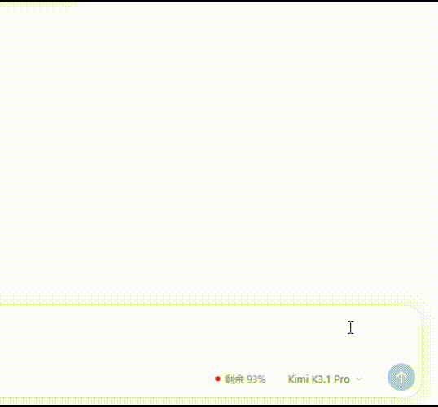

# dsh-model-allowance

[中文](README.zh.md)

Shows the balance or remaining allowance of the provider behind the current
conversation model.

The card also switches the session: the button next to the console link
lists the provider's models and moves the conversation to the one you pick.

## Usage



The card shows the provider's remaining balance or allowance and the model
of the current conversation, next to the input box.

## Configure credentials

Open **Settings → Model Allowance** to store the vendor credentials the
balance queries need, such as the Alibaba Cloud AccessKey ID/Secret behind
Qwen Token Plan readings. A testable pair is verified against the vendor's
own endpoints before it is saved; stored values can be edited or removed
later. Values live in DSH's credential store: they are never written into
configuration, never shown back, and reach nothing but the vendor's own
query endpoint. The guide under
[docs/qwen-token-plen-cn](docs/qwen-token-plen-cn/README.md) walks obtaining
the AccessKey pair.

## Supported

- DeepSeek
- MiniMax Coding Plan
- Zhipu Coding Plan
- Kimi for Coding
- OpenCode Go
- Xiaomi MiMo (pay-as-you-go balance and Token Plan)
- Qwen Token Plan (CN personal plan; needs the Alibaba Cloud AccessKey pair
  from **Settings → Model Allowance**)

### Not supported

These vendors publish no balance API. As long as they are configured here,
they still appear in the card: the panel says there is no balance API, and
their models stay switchable.

## Installation

### Install from npm (recommended)

1. Open the **Plugins** page in the DSH sidebar.
2. Choose **Install** and enter:

   ```
   dsh-model-allowance@1.1.1
   ```

   Use the latest published version instead of `1.1.1` when a newer one
   exists.
3. Confirm the installation. If DSH reports **restart required**, restart
   DSH; otherwise refresh the page.

The npm installation is eligible for the Plugin Manager's **Update** action.

### Install from GitHub

```
git+https://github.com/MeiK2333/dsh-model-allowance.git#v1.1.1
```

Git installations are not covered by the Plugin Manager's **Update** action;
updating means removing the old version first, then installing the new tag.

## Compatibility

DeepSeek Harness `>=0.2.1-rc.5 <0.3.0`.

## Development

Dependencies are managed with pnpm (`pnpm install --frozen-lockfile`).

## License

[MIT](LICENSE). Provider icons are trademarks of their respective owners,
used only to identify them.
