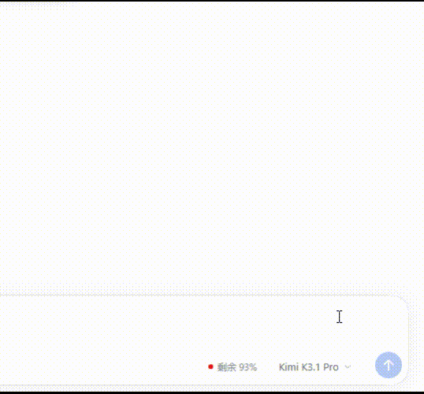

# dsh-model-allowance

[English](README.md)

显示当前会话所用模型对应厂商的余额或剩余额度。

卡片同时负责切换：控制台链接旁边的按钮会列出该厂商的模型，选中哪一个，
会话就切到哪一个。

## 使用



卡片显示厂商的余额或剩余额度，以及当前会话所用的模型，位于输入框旁。

## 支持

- DeepSeek
- MiniMax Coding Plan
- 智谱 Coding Plan
- Kimi for Coding
- OpenCode Go

### 不支持

以下厂商没有余额接口，但只要本地配置了它们，它们依然会出现在卡片里：
面板会提示“目前无余额接口”，模型列表照常可以切换。

- 千问 Token Plan：官方未提供余额接口
- Mimo Token Plan：官方未提供余额接口

## 安装

### 从 npm 安装（推荐）

1. 打开 DSH 侧边栏的 **Plugins（插件）** 页面。
2. 点击 **Install（安装）**，填入：

   ```
   dsh-model-allowance@1.0.0
   ```

   如果已有更新版本，请把 `1.0.0` 换成最新的精确版本。
3. 确认安装。如果 DSH 提示需要重启，重启 DSH；否则刷新页面即可。

通过 npm 安装的版本可以在 Plugin Manager 中使用 **Update** 更新。

### 从 GitHub 安装

```
git+https://github.com/MeiK2333/dsh-model-allowance.git#v1.0.0
```

Git 安装不受 Plugin Manager 的 **Update** 管理；更新时需要先移除旧版本，
再安装新的 tag。

## 兼容性

DeepSeek Harness `>=0.2.1-rc.5 <0.3.0`。

## 许可

[MIT](LICENSE)。各厂商图标为其所有者的商标，仅用于标识对应厂商。
