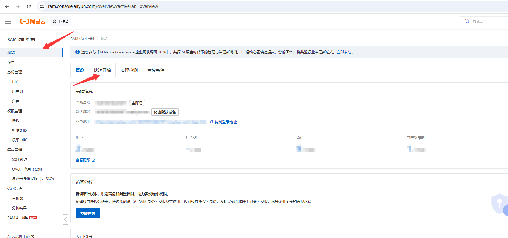
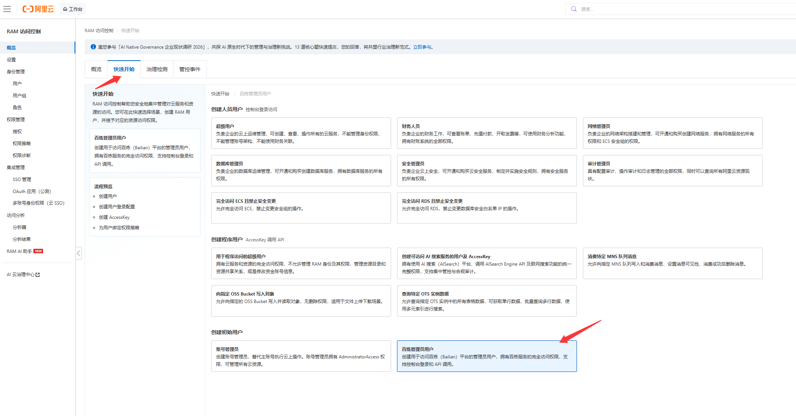
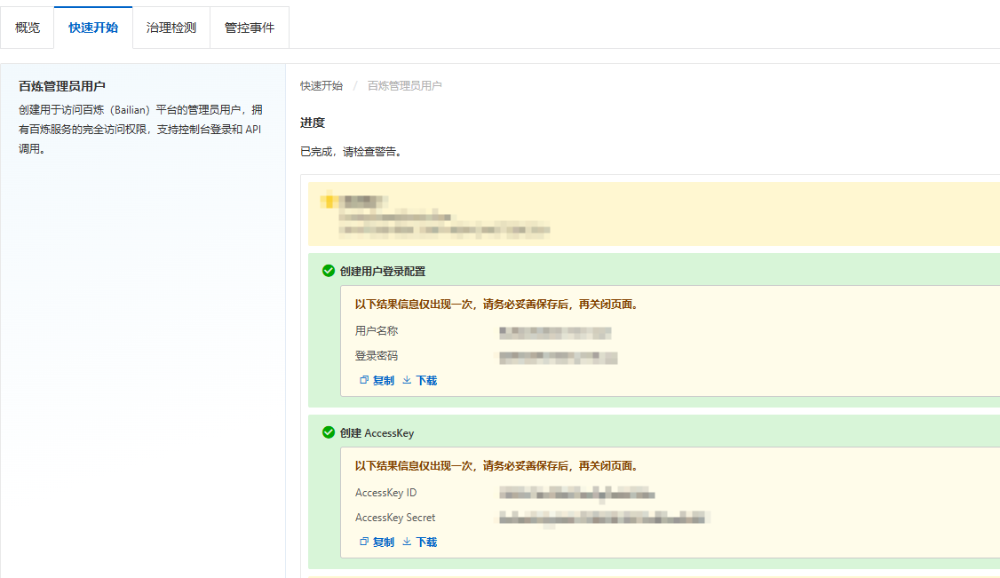
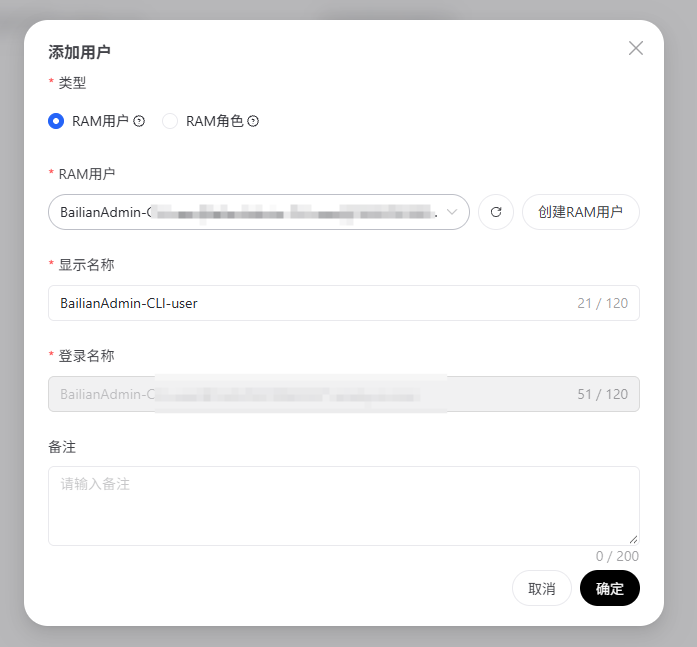
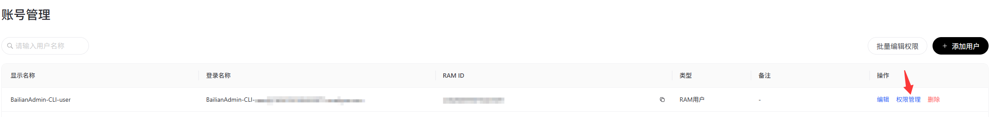
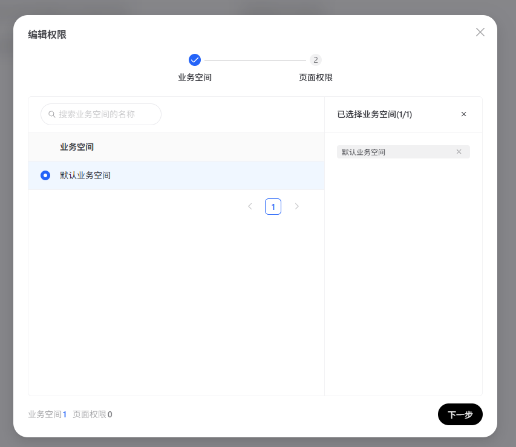
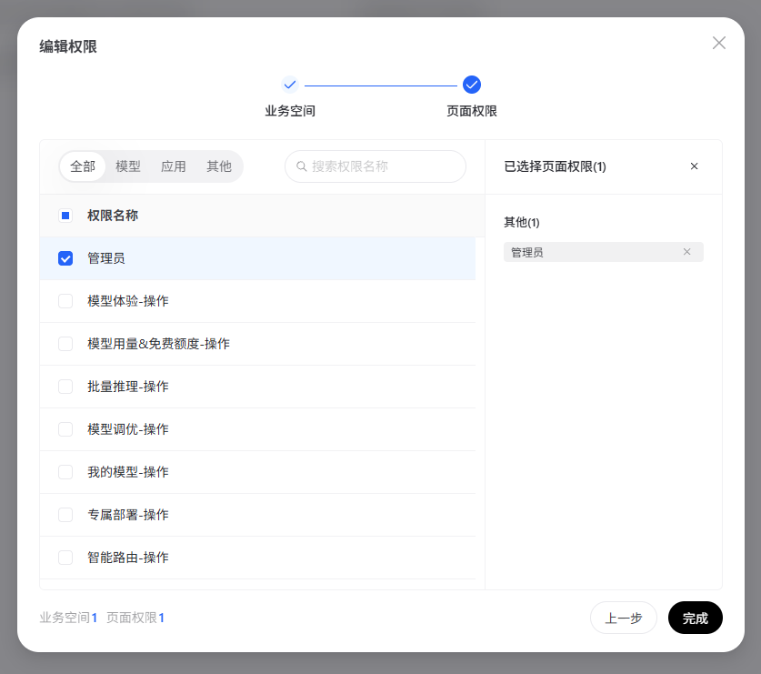
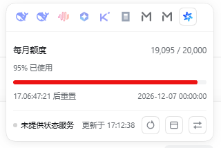

# 千问 Token Plan 余额查询配置指南

本文说明如何为 **dsh-model-allowance** 插件准备千问 Token Plan（国内个人版）的查询凭据，
让插件能在输入框旁的卡片中显示套餐余量、已用比例和重置时间。

流程分三段：阿里云侧创建百炼管理员用户 → 百炼侧给该用户授权 → 把 AccessKey 填进插件的凭据页。
全程约 3 分钟，只需要一个已实名认证的**阿里云主账号**（RAM 用户必须由主账号授权）。

> **安全提示**：本仓库所有截图中的账号名、AccessKey 均已打码。请同样保护好你自己的凭据，
> 不要把 AccessKey 写进代码、配置或 issue。

## 前置条件

- 一个已完成实名认证的阿里云**主账号**（RAM 用户必须由主账号授权）。
- 浏览器可访问 [RAM 访问控制](https://ram.console.aliyun.com/overview?activeTab=overview)
  与 [百炼控制台](https://bailian.console.aliyun.com/cn-beijing/settings/user-management)。

## 操作步骤

### 1. 在 RAM 创建「百炼管理员用户」

打开 [RAM 访问控制 · 概览](https://ram.console.aliyun.com/overview?activeTab=overview)，
切换到「快速开始」页签。

在「创建初始用户」区域点击 **百炼管理员用户**，按向导创建用户，并保存页面上的登录密码。
向导创建的用户已自带百炼管理权限，无需再手动绑定系统策略。

### 2. 记录 AccessKey

向导最后一步会为这个用户生成 AccessKey，**只显示一次**。

### 3. 在百炼控制台添加这个 RAM 用户

打开 [百炼控制台 · 用户管理](https://bailian.console.aliyun.com/cn-beijing/settings/user-management)，
点击「添加用户」，类型选「RAM用户」，选中步骤 1 创建的那个用户。

添加完成后，该用户出现在「账号管理」列表里。

### 4. 授予「默认业务空间」的权限

在该用户的「权限管理」中点击「添加权限」，在「业务空间」这一步选中 **默认业务空间**。

点「下一步」，在「页面权限」这一步勾选 **管理员**，再点「完成」。

> 「管理员」与「订阅套餐」两种权限都可以满足需求，这里统一用「管理员」。

### 5. 在插件中录入凭据并验证

打开 DSH 的 **设置 → Model Allowance**，在「阿里云（千问 Token Plan）」分组填入
AccessKey ID 与 AccessKey Secret，点「保存」。

随后插件卡片会显示该账号的套餐余量：

## 排查

| 现象 | 原因 | 处理 |
| --- | --- | --- |
| 查询返回 `BailianGateway.Team.NotAuthorised` | 百炼侧还没给该用户授权 | 回到步骤 4 补齐授权 |
| 卡片显示「未提供状态服务」 | 阿里云没有对外的厂商状态接口 | 正常现象，不影响余额显示 |
| 卡片里没有千问这一项 | 凭据未保存成功 | 确认保存后提示「已保存」 |
| 用了自己创建的 RAM 用户，报同样的错 | 该用户没被授予百炼所需的系统策略 | 给它加上 Token Plan 用量与费用中心的只读策略 |

## 安全须知

- AccessKey 只在 RAM 控制台显示一次，遗失只能轮换，不能找回。
- 用向导创建的「百炼管理员用户」即可，不必额外绑定系统策略；自行创建 RAM 用户时，
  只授予 Token Plan 用量与费用中心的只读策略，不要使用主账号的 AccessKey。
- 插件把凭据保存在本机的 DSH 凭据存储中：不写入配置文件、不会回显，
  也不会发往除阿里云查询接口外的任何地方。
- 怀疑泄露时，立即在 RAM 控制台禁用并轮换该 AccessKey。

## 参考

- [权限与使用规范（百炼 Token Plan）](https://help.aliyun.com/zh/model-studio/token-plan-permissions-and-usage)
- [管理 RAM 用户的权限](https://help.aliyun.com/zh/ram/user-guide/grant-permissions-to-the-ram-user)
